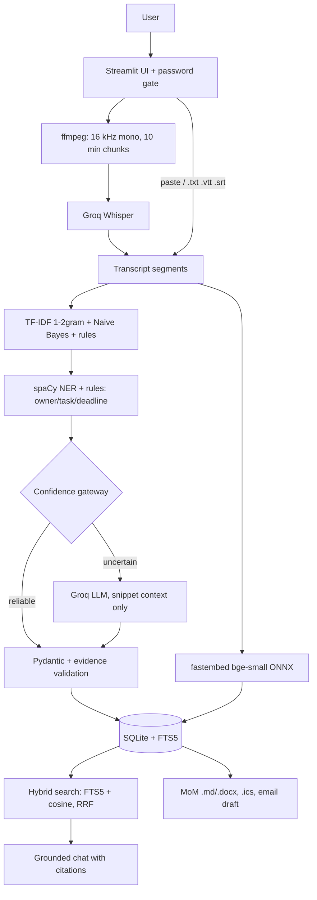

# Meeting AI (demo)

Hybrid **classical NLP + LLM** meeting intelligence: upload a recording or transcript, get a summary, candidate
decisions and action items (owner / deadline / evidence), search across meetings, ask grounded questions, and draft
Minutes of Meeting. **Demo only**: storage is temporary and the shared Groq key is rate-limited.



## Run locally
```bash
python3.12 -m venv .venv && source .venv/bin/activate
pip install -r requirements-dev.txt
cp .env.example .env        # fill GROQ_API_KEY and APP_PASSWORD (never commit .env)
streamlit run app.py
python -m pytest -q         # 50+ tests, no network or API key needed
```
Without `GROQ_API_KEY` the app still works for transcripts (classical NLP, search, MoM); audio transcription,
LLM fallback, abstractive summaries and LLM chat answers are disabled.

## Deploy (Streamlit Community Cloud, free)
1. Push this repo to GitHub (private is fine).
2. share.streamlit.io -> **Create app** -> pick the repo, branch `main`, main file `app.py`.
3. **Advanced settings**: Python **3.12**; paste secrets:
   ```toml
   GROQ_API_KEY = "gsk_..."
   APP_PASSWORD = "choose-a-password"
   ```
4. Deploy. `packages.txt` installs ffmpeg; `requirements.txt` installs everything else.
Storage is ephemeral: sample meetings are re-seeded on every start; user uploads may disappear on restart.

## Demo guard-rails
Password gate (fails closed if `APP_PASSWORD` is missing) · media <= 15 min / 50 MB · per-session caps on
transcriptions and LLM calls · uploaded audio is deleted right after transcription · extracted items are
*suggestions* until confirmed · the app never sends email or writes to a calendar (it prepares `.ics` / `.eml`).

## Configuration (env vars or Streamlit secrets)
`GROQ_API_KEY`, `APP_PASSWORD` (required) · `GROQ_LLM_MODEL` (default `llama-3.3-70b-versatile`) ·
`GROQ_ASR_MODEL` (default `whisper-large-v3-turbo`) · `CONF_MIN` (0.80) · `MARGIN_MIN` (0.15) · `MAX_AUDIO_MINUTES` ·
`MAX_UPLOAD_MB` · `SESSION_MAX_TRANSCRIPTIONS` · `SESSION_MAX_LLM_CALLS` · `EMBED_BACKEND` (`fastembed`|`hash`).

## Honest limitations
* The classifier is trained on **synthetic template data**; see Settings -> Classifier evaluation. Real meetings will
  score lower, which is what the confidence gateway / LLM fallback is for. Replace with real labelled data for serious use.
* Speaker diarization is not implemented (Groq has none). Speaker names come from labelled transcripts only.
* Embeddings are stored in SQLite and searched with numpy (fine for a demo's scale; ChromaDB was dropped because of
  the platform's SQLite version).
* Groq calls (Whisper, JSON-mode LLM) are covered by mocked tests only; verify with a real key after deploying.
* Only English is tuned (bge-small-en, en_core_web_sm).

## Layout
`app.py` + `pages/` (UI) · `services/` (config, db, auth, media, transcription, classical_nlp, extraction,
confidence_router, llm_service, pipeline, retrieval, query_router, chat_service, mom_service, actions_service) ·
`models/` (synthetic data generator, trained classifier + metrics) · `seed/` (sample meetings) · `tests/`.
